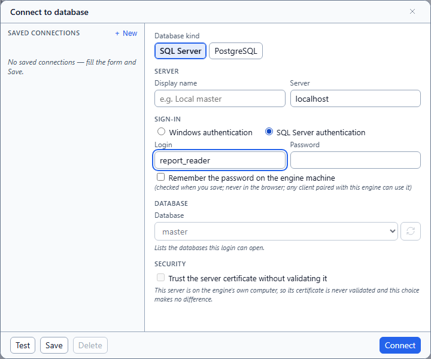

# Connecting to SQL Server

AKML SQL works with the connection your query window already uses. Connect in SSMS the way you normally do, and AKML SQL picks up the active connection, loads the database schema, and starts offering completions, hover info, and schema-aware features.

## Connect a query window

1. Open a new query window in SSMS.
2. Use the host's normal connection dialog to pick a server and database.
3. Once connected, AKML SQL loads the schema in the background. A small progress indicator shows while objects are loading.

If the schema does not load, see [Troubleshooting](troubleshooting.md).

## Windows Authentication vs SQL authentication

- **Windows Authentication**: nothing extra to do. AKML SQL uses your Windows identity through the existing connection.
- **SQL authentication**: when AKML SQL detects a SQL login connection, it may ask for the login and password the first time. Enter them in the credential dialog. AKML SQL validates the credential against the server before saving it.

Once a credential is saved, other query windows to the same server and login pick it up automatically — no re-typing.

## Where saved credentials live

Saved SQL-auth credentials are stored at:

```
%AppData%\AKML SQL\sql-credentials.json
```

- Passwords are encrypted with Windows DPAPI, scoped to your Windows user account. The file never contains plaintext passwords.
- Entries are stored per server and login.
- Passwords are never written to log files.
- The credential dialog offers a "Clear saved password" option if a password changes.
- You can turn credential saving off in Options under the IntelliSense section.

If a saved password stops working (for example, the server password changed), AKML SQL asks you to re-enter it and updates the stored credential.

## Test a connection

The credential dialog tests the login and password against the server before storing them. If the test fails, nothing is saved and you can correct the details immediately.

## Permissions the schema loader needs

For IntelliSense and schema-aware features to work fully, the connecting login needs `VIEW DATABASE STATE` and `VIEW ANY DEFINITION` on the database. Without them, schema loading fails and completion falls back to keywords only.

## Connecting in the browser

In the web edition you connect from **Connect to database** (the connection status in the status bar, or **Connect…** in the Schema panel). The browser is only the editor: the AKML engine opens the connection, from the engine machine.



- **Windows authentication** signs in as the account the engine runs as, not as your browser's Windows user. The web engine service runs as `NT AUTHORITY\SYSTEM`. SQL Server shows an account only the objects it may see, so without `VIEW DEFINITION` the Schema panel marks **Stored Procedures** and **Functions** as *may be incomplete* and says how to fix it (see [Troubleshooting](troubleshooting.md#stored-procedures-are-missing-from-the-explorer)).
- **Save** keeps the connection's name, server, database and login in this browser. It never keeps a password there.
- **Remember the password on the engine machine** (SQL authentication) asks the engine to keep the password. The option reads "(checked when you save; never in the browser; any client paired with this engine can use it)". With it ticked and the password typed, **Save** first checks the login against the server:
  - if the check succeeds, the dialog says "Saved. The engine machine keeps the password for *login*." The password is kept encrypted for the engine's account. On the web engine service, that means any administrator of the engine machine;
  - if it fails, the dialog says "Saved without the password: the login test failed —" and the server's reason. Nothing is kept;
  - with no engine that keeps passwords connected, the dialog says "Saved. No engine that keeps passwords is connected, so the password was not checked or kept.".
- **Forget it** removes a remembered password from the engine. Unticking Remember and saving does the same.
- Passwords saved by the SSMS extension are separate. They belong to your Windows account on your machine, the web engine runs as its own account, and it never reuses them.
- Saved connections and pairings belong to the address you opened. `http://localhost:…` and `http://127.0.0.1:…` are different addresses to the browser, so each has its own list. **Export settings** and **Import settings** (Settings) move your preferences between addresses or browsers. They do not move connections, pairings or passwords.

## Refresh the schema after changes

AKML SQL detects `CREATE`, `ALTER`, and `DROP` statements you run and refreshes its schema view automatically. To force a refresh, use **AKML SQL** -> **Help** -> **Refresh Schema Cache**.

Next: [IntelliSense](intellisense.md) and [AI Assistance](ai-assistance.md).
