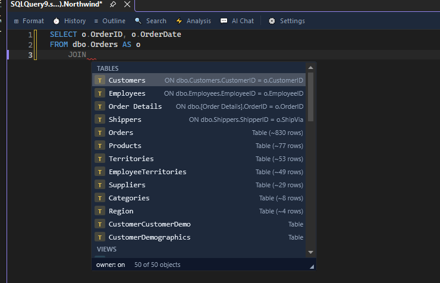
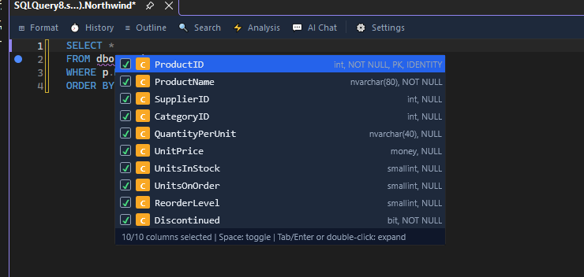

# IntelliSense

AKML SQL replaces the built-in completion list with a schema-aware IntelliSense engine. It reads your actual database, so suggestions match your tables, columns, and aliases — not just keywords.

## What gets completed

- SQL keywords (`SELECT`, `WHERE`, `JOIN`, ...)
- Tables, views, and other schema objects
- Columns, with data type, nullability, and PK/FK indicators
- Table aliases defined in your query
- Variables declared in the current script
- Built-in functions and stored procedures
- Your [snippets](snippets.md)
- JOIN suggestions based on foreign key relationships, with a ready-made `ON` clause



## The dot trigger

Type an alias or table name followed by `.` to list its columns:

```sql
SELECT o. FROM dbo.Orders o
```

After `o.` the popup shows the columns of `dbo.Orders` with type annotations such as `OrderID int PK`.

## Expand SELECT * with a column picker

Put the cursor right after the `*` in `SELECT *` and press **Tab**. A picker lists the columns of the tables in the query, each with its data type, nullability and key details. Every column starts checked.



- **Space** checks or clears the highlighted column.
- **Tab**, **Enter** or a double-click replaces the `*` with the checked columns.
- **Esc** closes the picker and leaves the `*` as it is.

The picker needs a query window connected to the database. To expand a `*` without choosing columns, use **Expand wildcards** in [Format SQL](formatting.md#choose-what-format-sql-does) or the [refactoring](refactoring.md#lightweight-refactorings) of the same name.

## Fuzzy matching and ranking

You do not need to type the exact prefix. Typing `cu` can match `CustomerID`. Suggestions are ranked by schema relevance, so columns and tables from the current query appear first.

## Quick Info on hover

Hover over a table, column, procedure, or variable to see a tooltip:

- Tables: object type, row-count estimate, column count, description
- Columns: data type, nullability, default value
- Procedures: parameter list and description
- Variables: declared type

## Signature help

Type `(` after a function or procedure name to see its parameter list. The tooltip highlights the current parameter as you type commas, and shows types, defaults, and direction for stored procedure parameters.

## The completion popup

- Each item has a type-coded icon badge, so you can tell columns, tables, keywords, and snippets apart at a glance.
- Hold **Ctrl** to make the popup semi-transparent, so you can read the code underneath without closing it.

## Tune IntelliSense

Open **AKML SQL** -> **Options…** -> **Suggestions** -> **Behavior** to adjust auto-trigger delay, maximum suggestions, fuzzy matching, keyword casing, and more. All keys are documented in the [Configuration reference](../configuration.md).

## Avoid conflicts with built-in IntelliSense

On first run, AKML SQL offers to disable SSMS's native IntelliSense so only one popup appears. You can change this later on the IntelliSense options page.
