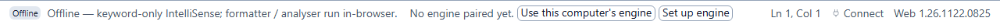

# Troubleshooting

Most problems come down to a stale IDE cache, a stopped engine process, or a missing setting. Work through the sections below in order.

## Check the logs first

AKML SQL writes daily log files to:

```
%AppData%\AKML SQL\logs\
```

Each AKML SQL process — the SSMS extension, the engine (IntelliSense, formatting, AI) and the updater — writes its own file, so one day's log is spread over `akmlsql-YYYYMMDD.log`, `akmlsql-YYYYMMDD_001.log`, `_002` and so on. The easiest way to read them is **AKML SQL** -> **View Logs**: it opens on the newest day with every file merged, newest entries first, and a **Source** column naming the process. Set **Level** to `ERR` to see only errors. If you open the files by hand, search all of the day's files for `ERR` — the highest-numbered file is just the process that started last. For more detail, set `logMinimumLevel` to `"Debug"` or `"Verbose"` in `config.json` and restart the IDE.

## Where settings live

```
%AppData%\AKML SQL\config.json
```

The file is created with defaults on first run and written safely (temp file plus rename), so it should not corrupt. If you break it while editing by hand, delete it — a fresh default file is created on next start. Every key is documented in the [Configuration reference](../configuration.md).

## Update checking

- AKML SQL checks for updates on startup unless you turned this off; check manually with **AKML SQL** -> **Check for Updates**.
- The result of the last check is cached under `%AppData%\AKML SQL\` and shown as a notification bar.
- "Could not check for updates" means the machine could not reach the network.

## After an SSMS update

IDE updates can leave a stale component cache, which stops extensions from loading. Clear the cache and restart:

- SSMS 22: delete `%LocalAppData%\Microsoft\SSMS\22.0_*\ComponentModelCache\`

```powershell
#Clear all SSMS 22 caches (PowerShell)
Remove-Item "$env:LOCALAPPDATA\Microsoft\SSMS\22*\ComponentModelCache" -Recurse -Force
```

Do the same after installing or upgrading AKML SQL if the menu does not appear.

## The AKML SQL menu is missing

1. Clear the component cache as above and restart the IDE.
2. Check the IDE's `ActivityLog.xml` (under `%AppData%\Microsoft\SSMS\22.0_*\` or `%AppData%\Microsoft\VisualStudio\18.0_*\`) for load errors.
3. Verify the extension files exist in the IDE's Extensions folder — for SSMS 22 they must be under the `Release\Common7\IDE\Extensions\AkmlSql\` subfolder.
4. Re-run the installer; it repairs in place and clears the caches for you.

## IntelliSense or schema features not working

1. Check Task Manager for `AkmlSql.Engine.exe` — the helper process that powers completions. If it is absent, look at the logs.
2. Confirm IntelliSense is enabled in **AKML SQL** -> **Options…** -> **Suggestions** -> **Behavior**.
3. If the built-in SSMS IntelliSense fights the AKML one, enable "Disable native IntelliSense" on that page.
4. If the schema never loads, confirm your login has `VIEW DATABASE STATE` and `VIEW ANY DEFINITION`, then refresh manually via **AKML SQL** -> **Help** -> **Refresh Schema Cache**.

## Web edition

### Handshake failed

- **Symptom.** The status bar says "Handshake failed. Check engine pairing." or reports that the engine did not answer, and nothing connects.
- **Cause.** The page is asking the wrong port, or the engine service is stopped. With IIS the page and the engine use two different ports.


- **Fix.** Find the **Bridge port:** line in the setup summary (`INSTALL-SUMMARY.txt` in `%ProgramData%\AKML SQL Web\`). Choose **Add engine…** in the status bar. It opens **Settings › Connections** with the address that did not answer filled in, so you can correct the port there. Check that the AKML SQL engine service is running (Services, `AkmlSqlWebEngine`).

### No engine paired yet

- **Symptom.** The status bar says "No engine paired yet."



- **Cause.** This browser has no engine saved at this address. That happens with a new browser, another address, or cleared site data. A page the engine serves itself (the standalone service) pairs with it on its own. With IIS, setup tells the page the engine's port (`akml-engine.json` in the site).
- **Fix.** When the engine runs on this computer, choose **Use this computer's engine** in the status bar. Otherwise choose **Set up engine** (it opens **Settings › Connections**) and **Add** under **Engine connections**. Enter the engine machine and its Bridge port, and the pairing PIN if it asks for one, then choose **Pair**. If nothing answers, the status bar says "No engine answered on …" and offers **Add engine…** with that address filled in (see Handshake failed).

### My saved connections are gone

- **Symptom.** **Connect to database** lists no saved connections, and Settings shows no paired engine.
- **Cause.** One of three things:
  - **Another address.** Saved connections and pairings belong to the address you opened, and `http://localhost:…` is not `http://127.0.0.1:…`. Opened at `127.0.0.1` with nothing saved, the page says so and offers **Open** at the other address and **Import settings…**.
  - **Cleared site data.** The browser's data for the site was cleared.
  - **Best-effort storage.** **Settings › Diagnostics › Browser storage** says whether this browser may clear the data when the disk is low.
- **Fix.** Open the address you used before. Settings export and import move your preferences, not connections or pairings, so add the connection again at the new address. No password is lost from the browser, because none is stored there.

### It asks for my password again

- **Symptom.** A saved SQL-authentication connection asks for its password each time.
- **Cause.** The browser never stores passwords. A password is kept only on the engine machine, and only when it was saved with **Remember the password on the engine machine** ticked and the password typed, after a login check that succeeded. A row saved without the password typed, or whose check failed, still asks.
- **Fix.** Open the connection and type the password. Tick **Remember the password on the engine machine** and choose **Save**. The dialog should say "Saved. The engine machine keeps the password for *login*." **Forget it** removes it again. Passwords saved in SSMS are not shared with the web engine.

### Stored procedures are missing from the explorer

- **Symptom.** The Schema panel shows fewer objects than the database has, often under **Stored Procedures (may be incomplete)**, or no tables at all. A note reads like "The engine signs in as NT AUTHORITY\SYSTEM, which cannot see every object in Northwind."
- **Cause.** SQL Server lists for an account only the objects it may see, and the account here lacks `VIEW DEFINITION` on the database. With Windows authentication from a browser on the engine's own computer the engine signs in as you, as SSMS does; it signs in as its own account (for the web engine service, `NT AUTHORITY\SYSTEM`) when the browser is on another computer, when it cannot tell who the browser's user is, or when `bridge.windowsSignInAsBrowserUser` is `false`.
- **Fix.** Open the page on the engine's computer, so Windows authentication signs in as you. Or connect with a login that can see the database. Or have a database administrator grant the account the note names, in that database: `GRANT VIEW DEFINITION TO [NT AUTHORITY\SYSTEM];` (and `db_datareader` to read its data).

## Report an issue

Open an issue on GitHub: https://github.com/mohamedkhamis/AKML-SQL/issues

Include: your SSMS version, the AKML SQL version (from **AKML SQL** -> **About**), what you did, what happened, and the relevant lines from the log file. Logs never contain passwords or API keys, but review them before attaching. You can also use the **Send Feedback** command in the AKML SQL menu.
